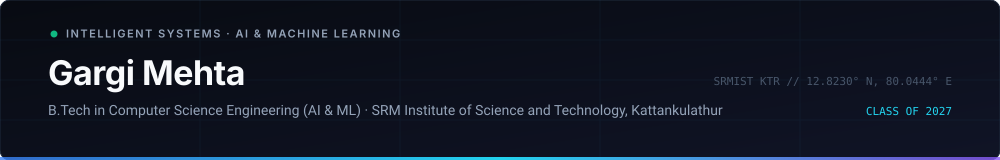

<!-- ═══════════════════════════════════════════════════════════════════
     1. HEADER BANNER
     ═══════════════════════════════════════════════════════════════════ -->

<!-- Typing tagline (only moving element) · plain-text alt as fallback -->

 

<!-- Availability badge -->

  

<!-- ═══════════════════════════════════════════════════════════════════
     2. INTRO (2 lines) + 4 LINK BADGES
     ═══════════════════════════════════════════════════════════════════ -->

B.Tech CSE (AI & ML) · SRM Institute of Science and Technology, Kattankulathur · Class of 2027 
Applied ML · deep vision pipelines · verifiable data architectures

  

&nbsp;

&nbsp;

&nbsp;

---

### ⚡ Featured Projects

<table>
  <tr>
    <td width="50%">
      <h4>🔋 <a href="https://github.com/Gaargimehta/blockchain-battery-passport">Blockchain Battery Passport</a></h4>
      
ML battery health (SOH / RUL) with on-chain attestation.

      <code>XGBoost</code> · <code>Blockchain</code> · <code>Streamlit</code>
    </td>
    <td width="50%">
      <h4>🥗 <a href="https://github.com/Gaargimehta/Nutivision">NutriVision</a></h4>
      
Food recognition and calorie estimation from images.

      <code>TensorFlow</code> · <code>OpenCV</code> · <code>CNN</code>
    </td>
  </tr>
  <tr>
    <td width="50%">
      <h4>🩺 <a href="https://github.com/Gaargimehta/upj-obstruction-ml">UPJ Obstruction ML</a></h4>
      
Pediatric clinical decision support for surgical triage.

      <code>PyTorch</code> · <code>XGBoost</code> · <code>Scikit-learn</code>
    </td>
    <td width="50%">
      <h4>🛣️ <a href="https://github.com/Gaargimehta/Potholes-detection">Pothole Detection</a></h4>
      
Real-time YOLOv8 road hazard detection with GPS tagging.

      <code>YOLOv8</code> · <code>CUDA</code> · <code>FastAPI</code>
    </td>
  </tr>
  <tr>
    <td width="50%">
      <h4>📈 <a href="https://github.com/Gaargimehta/groww-code-watchlist">Smart Market Watchlist</a></h4>
      
Market anomaly detection surfacing real-time attention scores.

      <code>FastAPI</code> · <code>React</code> · <code>Docker</code>
    </td>
    <td width="50%">
      <h4>📬 <a href="https://github.com/Gaargimehta/Email-Job-Scheduler-Dashboard">Email Job Scheduler</a></h4>
      
BullMQ + Redis scheduler with a live observability dashboard.

      <code>BullMQ</code> · <code>Redis</code> · <code>Node.js</code>
    </td>
  </tr>
</table>

---

### 🛠️ Core Stack

  

 

<!-- Highlights — collapsed -->

<b>🔍 More about me</b>

 

- 🌐 **Google Cloud Generative AI Virtual Intern** — AICTE-EduSkills program, Outstanding (O) Grade
- 🏆 **SIH 2025 National Finalist** — Smart India Hackathon, Ministry of Education / AICTE
- 📊 **SAP Certified Data Analyst** — SAP Analytics Cloud Global Certification
- ⚖️ **LexGuard** *(research prototype)* — Multilingual legal document AI for clause-level risk analysis across Indian languages
- 🎓 **Community Educator** — Volunteer AI & digital literacy teacher for 50+ rural students, Mahatma Gandhi Govt. School, Rajasthan

---

### 📊 GitHub Stats

  
  &nbsp;&nbsp;
  

<!-- Fallback: if the vercel instance above is rate-limited (HTTP 429 / blank card),
     replace "github-readme-stats.vercel.app" with one of these mirrors:
       • https://github-readme-stats-eight-theta.vercel.app
       • https://github-readme-stats.zohan.tech                           -->

---

  Building intelligent things, one commit at a time.

