<div align="center">

<!-- Cosmic Header SVG Banner -->


<br/><br/>

# Hey, I'm Gargi 👋

### **AI/ML Developer | Future AI Engineer | Exploring Intelligent Systems**

> *"Building intelligent systems, exploring the unknown, and creating technology that matters."*

<!-- Animated Typing Subtitle -->
<a href="https://github.com/Gaargimehta">
  
</a>

<br/>

<!-- Status Pill Badges -->
[-8B5CF6?style=for-the-badge&logo=mortarboard&logoColor=white)](https://www.srmist.edu.in/)
[](https://github.com/Gaargimehta)
[](https://www.linkedin.com/in/gargi-mehta-a2ba36300/)
[](https://www.linkedin.com/in/gargi-mehta-a2ba36300/)

<br/>

<!-- Visitor Counter Badge -->


</div>

<br/>

<p align="center">
  
</p>

## 🌌 Telemetry & Mission Brief (About Me)

```yaml
╭──────────────────────────────────────────────────────────────────────────────╮
│  🚀 IDENTITY      : Gargi Mehta                                              │
│  📍 ORBIT / BASE  : SRM Institute of Science and Technology, Chennai, India  │
│  🎓 SPECIALIZATION: B.Tech Computer Science Engineering (AI & Machine Learn) │
│  ⚡ CORE MISSION  : Bridging Deep Learning, LLM Architectures & CleanTech    │
│  🔭 CURRENT WORK  : EV Battery Passport ML Attestation & Multilingual RAG   │
╰──────────────────────────────────────────────────────────────────────────────╯
```

I am a Computer Science undergraduate specializing in **Artificial Intelligence & Machine Learning** at **SRMIST KTR** (Class of 2027, CGPA 8.2). I am intensely curious about the intersection of rigorous mathematical foundations and scalable machine intelligence.

My engineering journey revolves around turning complex models into impactful, real-world systems:
- 🧠 **Intelligent Applications**: Designing neural architectures that solve tangible diagnostic, health, and urban infrastructure problems.
- 🔬 **Machine Learning & Deep Learning**: Experimenting with convolutional pipelines, tree ensembles, and predictive degradation modeling.
- 💬 **NLP & Large Language Models**: Understanding attention mechanisms, building RAG systems, and evaluating multilingual LLM reasoning.
- 🌱 **Sustainable Technology**: Pioneering data-driven clean-tech solutions, including blockchain-anchored EV battery health passports for circular economy valuation.
- 🤝 **Community & Mentorship**: Previously taught digital literacy and introductory AI to 50+ rural school students at Mahatma Gandhi Govt. School to bridge the educational gap.

<br/>

<p align="center">
  
</p>

## 🛠️ AI/ML-Focused Tech Stack

> *Curated strictly around Artificial Intelligence, Machine Learning, Data Science, and Production MLOps.*

### 🧬 Programming & Data Processing
| Category | Technologies | Status |
| :--- | :--- | :--- |
| **Languages** |    | `Currently Using` |
| **Data Engines** |    | `Currently Using` |
| **High-Perf Data** |  | `Exploring` |

### 🧠 Machine Learning & Deep Learning
| Framework | Focus | Status |
| :--- | :--- | :--- |
|  | Neural Network Architecture, Tensor Operations, Training Loops | `Currently Using` |
|   | Deep Learning, Sequential Models, Transfer Learning | `Currently Using` |
|  | Classical ML, Feature Engineering, Regression, Clustering | `Currently Using` |
|  | Gradient Boosted Trees for Tabular Health & Battery Telemetry | `Currently Using` |
|  | Image Filtering, Contours, Morphological Preprocessing | `Currently Using` |
| **CNNs & Computer Vision** | Real-Time Edge Vision, Object Detection (YOLOv8) | `Currently Using` |

### 💬 NLP & Large Language Models
| Domain | Techniques & Frameworks | Status |
| :--- | :--- | :--- |
| **Foundations** | Tokenization, N-grams, TF-IDF, Word2Vec, Semantic Search | `Currently Using` |
| **RAG Pipelines** | Chunking Strategies, Retrieval-Augmented Generation, Context Injection | `Exploring & Building` |
| **Vector Databases** | FAISS, ChromaDB, Vector Embeddings | `Exploring & Building` |
| **Prompt Engineering** | Zero-Shot, Few-Shot, CoT (Chain-of-Thought) Structuring | `Currently Using` |
| **Model Optimization** | Parameter-Efficient Fine-Tuning (PEFT, LoRA / QLoRA) | `Exploring` |
| **Evaluation** | Hallucination Detection, RAG Triad, LLM Output Metrics | `Exploring` |

### ✨ Generative AI
| Capability | Scope & Architectures | Status |
| :--- | :--- | :--- |
| **LLMs** | Text Generation, Code Comprehension, Summarization | `Currently Using` |
| **Autonomous AI Agents**| ReAct Framework, Multi-Agent Tool Usage & Reflection | `Exploring` |
| **Diffusion Models** | Latent Diffusion, Image Synthesis Fundamentals | `Interested In` |
| **Multimodal AI** | Vision-Language Models (VLM), Cross-Modal Embeddings | `Interested In` |

### 📊 Data Science & Visualization
| Tool | Scope | Status |
| :--- | :--- | :--- |
|   | Statistical Data Plotting & Distribution Visualization | `Currently Using` |
|  | Interactive Telemetry & Multidimensional Analytics | `Currently Using` |
|  | Enterprise Dashboards & KPI Reporting | `Currently Using` |
|  | Certified Enterprise Data Analytics & Forecasting | `Certified` |
|  | Exploratory Data Analysis & Rapid Prototyping | `Currently Using` |

### ⚙️ Deployment & MLOps
| Tool | Application | Status |
| :--- | :--- | :--- |
|  | Containerization of ML Services & Reproducible Environments | `Currently Using` |
|  | High-Performance Asynchronous Python Inference Endpoints | `Currently Using` |
|  | Interactive ML Dashboards & Model Demonstration Interfaces | `Currently Using` |
|   | Version Control, Branching Workflows, CI/CD Actions | `Currently Using` |
|  | Experiment Tracking, Loss Tracking & Hyperparameter Tuning | `Exploring` |

### ☁️ Cloud & Databases
| Platform | Focus Area | Status |
| :--- | :--- | :--- |
|  | Generative AI Studio, Vertex AI, Cloud Storage | `Completed Internship` |
|  | Unstructured Document Storage & JSON Analytics | `Currently Using` |
|  | Lightweight Local Data Persistence for Model Runs | `Currently Using` |
|  | Cloud Compute (EC2, S3) for ML Pipelines | `Interested In` |

<br/>

<p align="center">
  
</p>

## 🚀 Featured AI/ML Projects

```
========================================================================================
   MISSION-CRITICAL ARTIFACTS · PREDICTIVE MODELS · INTELLIGENT SYSTEMS · REAL REPOS
========================================================================================
```

### 🛰️ 01. [Blockchain-Anchored Battery Passport](https://github.com/Gaargimehta/blockchain-battery-passport)
> **Verifiable Trust Architecture for Second-Life EV Battery Valuation & Circularity**

- **Problem**: As millions of electric vehicles retire batteries, the lack of verifiable degradation data prevents safe repurposing for stationary solar storage, causing hazardous electronic waste.
- **Solution**: Developed a dual-layer architecture pairing ML models (Random Forest, XGBoost) for **State-of-Health (SOH)** and **Remaining Useful Life (RUL)** estimation with cryptographically signed on-chain smart contract attestations. Aligned with **EU Regulation 2023/1542** and **India BWMR 2022**.
- **Tech Stack**: `Python`, `XGBoost`, `Scikit-learn`, `Blockchain Smart Contracts`, `Streamlit`, `Pandas`
- **Links**: [](https://github.com/Gaargimehta/blockchain-battery-passport)

---

### 🥗 02. [NutriVision — AI Food Nutrition & Health Analyser](https://github.com/Gaargimehta/Nutivision)
> **Computer Vision & Deep Learning Meal Classification and Calorie Decomposition**

- **Problem**: Manual nutritional tracking is tedious, error-prone, and unsustainable for users managing lifestyle diseases or dietary constraints.
- **Solution**: Engineered an end-to-end computer vision and deep CNN model that takes single meal imagery, classifies food items, estimates portion volume and oil concentration, and computes macronutrient metrics (protein, carbs, fats) with automated health categorization (healthy / moderate / unhealthy).
- **Tech Stack**: `Python`, `OpenCV`, `TensorFlow`, `Keras`, `CNNs`, `Pandas`, `NumPy`
- **Links**: [](https://github.com/Gaargimehta/Nutivision)

---

### 🩺 03. [UPJ Obstruction Clinical Decision ML](https://github.com/Gaargimehta/upj-obstruction-ml)
> **Clinically Aligned Pediatric Nephrology Decision Support System**

- **Problem**: Pediatric Ureteropelvic Junction (UPJ) obstruction requires nuanced differential diagnosis to prevent permanent renal damage while avoiding unwarranted invasive surgery.
- **Solution**: Constructed an end-to-end clinical machine learning pipeline evaluating patient physiological indicators and diagnostic imaging metrics to provide risk stratification, assisting clinicians in triage and follow-up planning.
- **Tech Stack**: `Python 3.10+`, `PyTorch 2.0+`, `XGBoost`, `Scikit-learn`, `Streamlit`
- **Links**: [](https://github.com/Gaargimehta/upj-obstruction-ml)

---

### 🛣️ 04. [GPU-Accelerated Real-Time Pothole Detection](https://github.com/Gaargimehta/Potholes-detection)
> **YOLOv8 + CUDA Road Surface Hazard Detection for Smart Cities**

- **Problem**: Undetected road distress causes vehicular damage and severe transit accidents in rapidly growing urban centers.
- **Solution**: Deployed an optimized deep learning edge pipeline utilizing **YOLOv8** accelerated via **CUDA** for real-time pothole bounding-box detection, automated GPS coordinate stamping, and ingestion into a municipal geospatial hazard map.
- **Tech Stack**: `Python`, `YOLOv8`, `PyTorch`, `OpenCV`, `CUDA`, `FastAPI`
- **Links**: [](https://github.com/Gaargimehta/Potholes-detection)

---

### ⚖️ 05. LexGuard — AI Legal Document Risk Analysis
> **Multilingual Legal Contract Analyzer with Contextual NLP & Clause Auditing**

- **Problem**: Legalese in complex agreements obfuscates high-risk obligations, liabilities, and unfair indemnity clauses for non-lawyers and non-English speakers.
- **Solution**: Implemented a multilingual natural language processing pipeline that ingests commercial contracts, performs risk classification on indemnification, termination, and confidentiality clauses, and outputs simplified summaries across Indian regional languages (Hindi, English, Bengali, Tamil, Telugu).
- **Tech Stack**: `Python`, `NLP`, `Vector DB`, `RAG`, `FastAPI`
- **Origin**: *Developed as a practical research implementation following Google Cloud Generative AI Internship.*

<br/>

### 🌌 Explore All Projects (Ecosystem & Systems Engineering)
Every project represents an intentional step in systems mastery. Additional deployed architectures include:
- 📈 **[Smart Market Watchlist](https://github.com/Gaargimehta/groww-code-watchlist)**: Retail market intelligence engine computing statistical Attention Scores and "Since You Last Checked" anomaly digests without noisy tick clutter. (`Python`, `Docker`, `FastAPI`, `TypeScript`)
- 📨 **[Production Email Job Scheduler](https://github.com/Gaargimehta/Email-Job-Scheduler-Dashboard)**: High-throughput distributed BullMQ + Redis job scheduler and real-time observability dashboard with Elasticsearch and PostgreSQL. (`TypeScript`, `BullMQ`, `Redis`, `PostgreSQL`)

<br/>

<p align="center">
  
</p>

## 🧠 Currently Exploring

```
╭─────────────────────────────────────────────────────────────────────────────╮
│  RADAR NODE        │ RESEARCH INQUIRY & PRACTICAL EXPERIMENTATION           │
├────────────────────┼────────────────────────────────────────────────────────┤
│  Transformers      │ Self-Attention heads, KV-cache latency, FlashAttention │
│  Advanced RAG      │ Hybrid dense/sparse search, reranking & Hallucination  │
│  Autonomous Agents │ ReAct architectures, memory retention, tool grounding  │
│  Quantization      │ 4-bit / 8-bit QLoRA fine-tuning for edge inference     │
│  Sustainable AI    │ Energy efficiency benchmarks & green computing models  │
╰─────────────────────────────────────────────────────────────────────────────╯
```

- 🔬 **Deep Learning Architectures**: Dissecting transformer mechanisms, multi-head attention dynamics, and cross-attention in multimodal setups.
- 📚 **Retrieval-Augmented Generation (RAG)**: Exploring hierarchical chunking, vector database index optimization, and semantic graph hybrid retrieval.
- 🤖 **Agentic Workflows**: Investigating multi-agent systems that autonomously reason, write test suites, and execute multi-step research tasks.
- ⚡ **Model Compression**: Testing LoRA, QLoRA, and FP8/INT4 weight quantization to run intelligent models on resource-constrained devices.
- 🌱 **Green & Sustainable Computing**: Quantifying compute energy footprints during model training and exploring carbon-aware inference scheduling.

<br/>

<p align="center">
  
</p>

## 📊 GitHub Deep Space Telemetry

<div align="center">

<table border="0">
  <tr>
    <td align="center" width="50%">
      
    </td>
    <td align="center" width="50%">
      
    </td>
  </tr>
  <tr>
    <td align="center" colspan="2">
      <br/>
      
    </td>
  </tr>
</table>

<br/>

<!-- Activity Graph -->


</div>

<br/>

<p align="center">
  
</p>

## 🏆 Achievements, Certifications & Milestones

- 🌐 **Generative AI Virtual Intern — Google Cloud (AICTE-EduSkills)**: Finished a 10-week intensive generative AI curriculum with an **Outstanding (O) Grade**. Mastered foundational LLM concepts and generative tooling.
- 📊 **SAP Certified: Data Analyst — SAP Analytics Cloud**: Validated proficiency in enterprise cloud analytics, multi-source data modeling, and predictive dashboarding.
- 🚍 **Smart India Hackathon (SIH) 2025**: Designed and built an AI-powered real-time public transit tracking and route optimization prototype under national competition standards.
- ⚡ **OSSOME HACKS 2.0 (GitHub Community SRM, 2024)**: Built and presented an applied ML prototype within strict 36-hour hackathon constraints.
- 📜 **MathWorks Certified**: Machine Learning Onramp, Image Processing Onramp, and MATLAB Onramp credentials.
- 🐍 **Cisco Certified**: Python Essentials Certification.
- 🎓 **Coursera Certified**: Supervised Machine Learning (Stanford Online / DeepLearning.AI).
- 🧩 **Competitive Problem Solving**: Active participant on HackerRank, LeetCode, and CodeChef focusing on Data Structures & Algorithms.

<br/>

<p align="center">
  
</p>

## 🛰️ Contact & Cosmic Coordinates

Whether you want to discuss research collaborations, machine learning internships, sustainable AI, or intelligent systems — my communication frequencies are open.

<div align="center">

<a href="https://www.linkedin.com/in/gargi-mehta-a2ba36300/">
  
</a>
&nbsp;
<a href="mailto:gargimehta022@gmail.com">
  
</a>
&nbsp;
<a href="mailto:gm3300@srmist.edu.in">
  
</a>
&nbsp;
<a href="https://github.com/Gaargimehta">
  
</a>
&nbsp;
<a href="assets/Gargi_Mehta_Resume.pdf">
  
</a>

<br/><br/>

---

*Designed with 💜 and cosmic curiosity by **Gargi Mehta** · Powered by AI & Sustainable Code*  
*"Ad astra per aspera — Through hardships to the stars."*

</div>
