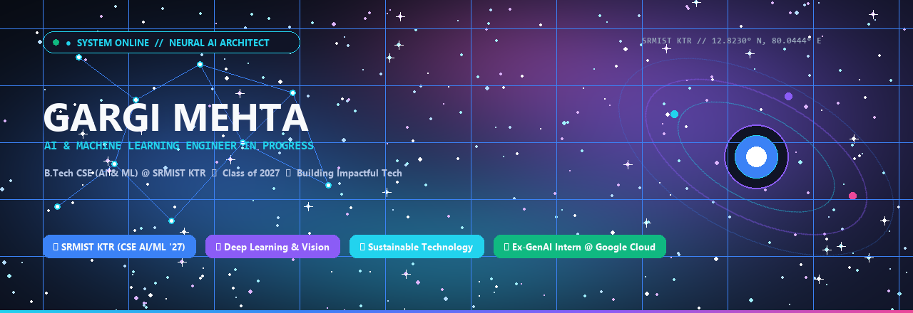
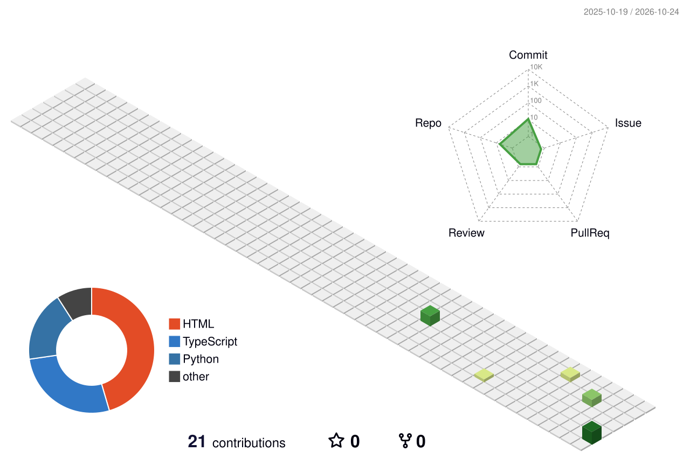

<div align="center">

<!-- Header Banner -->


<br/><br/>

# Hey there! I'm Gargi 👋

### **AI & Machine Learning Engineer in Progress | Computer Science Undergraduate**

> *"Building intelligent systems, exploring the unknown, and creating technology that matters."*

<!-- Animated Typing Effect -->
<a href="https://github.com/Gaargimehta">
  
</a>

<br/>

<!-- Social Badges Section -->
<a href="https://www.linkedin.com/in/gargi-mehta-a2ba36300/">
  
</a>
&nbsp;
<a href="https://github.com/Gaargimehta">
  
</a>
&nbsp;
<a href="https://gaargimehta.github.io/Gaargimehta/">
  
</a>
&nbsp;
<a href="mailto:gargimehta022@gmail.com">
  
</a>
&nbsp;
<a href="assets/Gargi_Mehta_Resume.pdf">
  
</a>

<br/><br/>

<!-- Quick Status Pills -->
[-3B82F6?style=flat-square&logo=mortarboard&logoColor=white)](https://www.srmist.edu.in/)
[](https://github.com/Gaargimehta)
[](https://www.linkedin.com/in/gargi-mehta-a2ba36300/)
[](https://www.linkedin.com/in/gargi-mehta-a2ba36300/)

</div>

<br/>

<p align="center">
  
</p>

## 🌌 About Me

<table>
  <tr>
    <td width="60%" valign="top">
      <p>
        I am a Computer Science undergraduate specializing in <strong>Artificial Intelligence &amp; Machine Learning</strong> at 
        <strong>SRM Institute of Science and Technology, Kattankulathur</strong> (Class of 2027, CGPA 8.2).
      </p>
      <p>
        My technical passion lies at the intersection of mathematical machine learning, computer vision, and scalable intelligence. I am committed to engineering systems that are mathematically rigorous, verifiable, and impactful in real-world domains.
      </p>
      <p>
        <strong>What Drives Me:</strong>
        <br/>
        ✦ <strong>Intelligent Systems:</strong> Building end-to-end predictive pipelines and neural vision systems.
        <br/>
        ✦ <strong>Sustainable Technology:</strong> Designing ML architectures for EV battery passports and clean-tech circularity.
        <br/>
        ✦ <strong>Continuous Learning:</strong> Mastering data structures, algorithms, and generative AI research papers.
        <br/>
        ✦ <strong>Community Impact:</strong> Volunteered in rural Rajasthan, teaching foundational AI and digital literacy to 50+ students.
      </p>
    </td>
    <td width="40%" valign="top">
      <div align="center">
        <code><b>🚀 TELEMETRY HUD</b></code>
      </div>

```yaml
Base        : SRMIST KTR, Chennai
Specialism  : B.Tech CSE (AI/ML)
Graduation  : May 2027
CGPA        : 8.2 / 10.0
Focus       : ML • Deep Learning • Vision
Internship  : Google Cloud GenAI (Grade O)
Cert        : SAP Certified Data Analyst
Current Goal: Skilled AI/ML Engineer
```
    </td>
  </tr>
</table>

<br/>

<p align="center">
  
</p>

## 🛠️ Tech Stack & Skills

### 💻 Programming Languages
<p align="left">
  <a href="https://skillicons.dev">
    
  </a>
</p>

### 🧠 Artificial Intelligence & Machine Learning
<p align="left">
  <a href="https://skillicons.dev">
    
  </a>
</p>

### 🌐 Web Development
<p align="left">
  <a href="https://skillicons.dev">
    
  </a>
</p>

### ⚙️ Tools & Platforms
<p align="left">
  <a href="https://skillicons.dev">
    
  </a>
</p>

<br/>

<p align="center">
  
</p>

## 🚀 Featured Projects

<table width="100%">
  <tr>
    <td width="50%" valign="top">
      <h3>🛰️ <a href="https://github.com/Gaargimehta/blockchain-battery-passport">Blockchain Battery Passport</a></h3>
      <p><strong>A Verifiable ML Trust Architecture for Second-Life EV Battery Valuation</strong></p>
      <p>
        Addresses the lack of transparent degradation data for retired EV batteries. Pairs Machine Learning (Random Forest, XGBoost) for <strong>State-of-Health (SOH)</strong> and <strong>Remaining Useful Life (RUL)</strong> estimation with cryptographically signed smart contracts, aligned with EU Regulation 2023/1542 and India BWMR 2022.
      </p>
      <p>
        <code>Python</code> <code>XGBoost</code> <code>Scikit-learn</code> <code>Blockchain</code> <code>Streamlit</code>
      </p>
      <p>
        <a href="https://github.com/Gaargimehta/blockchain-battery-passport">
          
        </a>
      </p>
    </td>
    <td width="50%" valign="top">
      <h3>🥗 <a href="https://github.com/Gaargimehta/Nutivision">NutriVision — AI Food Analyser</a></h3>
      <p><strong>Computer Vision &amp; Deep Learning Meal Nutrition and Calorie Decomposition</strong></p>
      <p>
        End-to-end computer vision system analyzing single meal images to classify food categories, compute volumetric portion estimates, evaluate oil concentration, and calculate comprehensive macronutrient metrics with automated health index grading.
      </p>
      <p>
        <code>Python</code> <code>OpenCV</code> <code>TensorFlow</code> <code>Keras</code> <code>CNNs</code> <code>Pandas</code>
      </p>
      <p>
        <a href="https://github.com/Gaargimehta/Nutivision">
          
        </a>
      </p>
    </td>
  </tr>
  <tr>
    <td width="50%" valign="top">
      <h3>🩺 <a href="https://github.com/Gaargimehta/upj-obstruction-ml">UPJ Obstruction Clinical Decision ML</a></h3>
      <p><strong>Clinically Aligned Pediatric Nephrology Decision Support System</strong></p>
      <p>
        Designed to support clinicians in pediatric Ureteropelvic Junction (UPJ) obstruction management. Evaluates clinical physiological indicators and imaging biomarkers to provide risk stratification, aiding in differential surgical triage.
      </p>
      <p>
        <code>Python 3.10+</code> <code>PyTorch 2.0+</code> <code>XGBoost</code> <code>Scikit-learn</code> <code>Streamlit</code>
      </p>
      <p>
        <a href="https://github.com/Gaargimehta/upj-obstruction-ml">
          
        </a>
      </p>
    </td>
    <td width="50%" valign="top">
      <h3>🛣️ <a href="https://github.com/Gaargimehta/Potholes-detection">Smart City Pothole Detection</a></h3>
      <p><strong>GPU-Accelerated Real-Time YOLOv8 Road Hazard Pipeline</strong></p>
      <p>
        Real-time deep learning pipeline combining YOLOv8 with CUDA hardware acceleration for high-frame-rate road hazard bounding-box detection, automated GPS coordinate stamping, and municipal map integration.
      </p>
      <p>
        <code>Python</code> <code>YOLOv8</code> <code>PyTorch</code> <code>CUDA</code> <code>OpenCV</code> <code>FastAPI</code>
      </p>
      <p>
        <a href="https://github.com/Gaargimehta/Potholes-detection">
          
        </a>
      </p>
    </td>
  </tr>
  <tr>
    <td width="50%" valign="top">
      <h3>⚖️ LexGuard — Legal Document AI</h3>
      <p><strong>Multilingual NLP Contract Risk Analysis &amp; Clause Simplification</strong></p>
      <p>
        Audits commercial agreements for non-lawyers by parsing high-risk indemnity and termination clauses, summarizing dense legalese into 5 Indian languages (Hindi, English, Bengali, Tamil, Telugu) with grounded citations.
      </p>
      <p>
        <code>Python</code> <code>NLP</code> <code>Vector Embeddings</code> <code>RAG</code> <code>FastAPI</code>
      </p>
      <p>
        
      </p>
    </td>
    <td width="50%" valign="top">
      <h3>🌌 Explore All Projects (Systems Engineering)</h3>
      <p><strong>Distributed Architecture &amp; Market Intelligence Systems</strong></p>
      <p>
        ✦ <strong><a href="https://github.com/Gaargimehta/groww-code-watchlist">Smart Market Watchlist</a>:</strong> Market intelligence engine computing statistical Attention Scores for retail investors. (<code>Python</code>, <code>Docker</code>, <code>FastAPI</code>)<br/>
        ✦ <strong><a href="https://github.com/Gaargimehta/Email-Job-Scheduler-Dashboard">Email Job Scheduler</a>:</strong> Distributed BullMQ + Redis job scheduler with PostgreSQL &amp; Elasticsearch. (<code>TypeScript</code>, <code>BullMQ</code>)
      </p>
      <p>
        <a href="https://gaargimehta.github.io/Gaargimehta/">
          
        </a>
      </p>
    </td>
  </tr>
</table>

<br/>

<p align="center">
  
</p>

## 📊 GitHub Analytics Dashboard

<div align="center">

<table border="0">
  <tr>
    <td align="center" width="50%">
      
    </td>
    <td align="center" width="50%">
      
    </td>
  </tr>
  <tr>
    <td align="center" colspan="2">
      <br/>
      
    </td>
  </tr>
</table>

</div>

<br/>

<p align="center">
  
</p>

## 🧊 3D Contribution Calendar

<div align="center">
  
</div>

<br/>

<p align="center">
  
</p>

## 🐍 Contribution Snake Animation

<div align="center">
  
</div>

<br/>

<p align="center">
  
</p>

## 🧠 What I'm Exploring

```yaml
╭─────────────────────────────────────────────────────────────────────────────╮
│  RADAR INQUIRIES & PRACTICAL RESEARCH                                       │
├─────────────────────────────────────────────────────────────────────────────┤
│  🔬 Machine Learning      : Tree Ensembles, Loss Topography & Regularization│
│  🧠 Deep Learning         : Convolutional Vision, Transformers & Attention │
│  🧩 DSA Mastery           : Advanced Graphs, Dynamic Programming & Trees    │
│  ✨ Generative AI         : Multilingual RAG Pipelines & Autonomous Agents  │
│  👁️ Computer Vision       : YOLO Real-Time Inference, Edge CUDA Pipelines   │
│  🚀 Real-World Systems    : CleanTech EV Battery Passports & Diagnostics    │
╰─────────────────────────────────────────────────────────────────────────────╯
```

- 🔬 **Machine Learning Foundations**: Exploring statistical learning theory, loss surface curvature, and regularization methods.
- 🧠 **Deep Learning Architectures**: Dissecting multi-head self-attention, convolutional feature extractors, and residual networks.
- 🧩 **Data Structures & Algorithms**: Consistently sharpening problem-solving skills across LeetCode, HackerRank, and CodeChef.
- ✨ **Generative AI & LLMs**: Developing retrieval-augmented generation (RAG) systems with vector indexing and prompt engineering.
- 👁️ **Computer Vision**: Optimizing real-time object detection models for deployment on resource-constrained edge hardware.
- 🌍 **Real-World AI Deployment**: Applying machine learning to sustainable clean-tech, pediatric clinical support, and civic infrastructure.

<br/>

<p align="center">
  
</p>

## 🏆 Certifications & Achievements

- 🌐 **Generative AI Virtual Intern — Google Cloud (AICTE-EduSkills)**: Completed 10-week curriculum with **Outstanding (O) Grade**.
- 📊 **SAP Certified: Data Analyst — SAP Analytics Cloud**: Enterprise analytics modeling, predictive metrics, and reporting.
- 🚍 **Smart India Hackathon (SIH) 2025**: Designed real-time public transit tracking and route optimization prototype.
- ⚡ **OSSOME HACKS 2.0 (GitHub Community SRM)**: Built and presented an applied ML prototype under 36-hour hackathon constraints.
- 📜 **MathWorks Certified**: Machine Learning Onramp, Image Processing Onramp, and MATLAB Onramp credentials.
- 🐍 **Cisco Certified**: Python Essentials.
- 🎓 **Coursera Certified**: Supervised Machine Learning (Stanford Online / DeepLearning.AI).

<br/>

<p align="center">
  
</p>

<div align="center">

<!-- Visitor Counter -->


<br/><br/>

### *"Building intelligent things, one commit at a time."*

*Designed with 💜 by **Gargi Mehta** &bull; Powered by Curiosity &amp; Sustainable Code*

</div>
