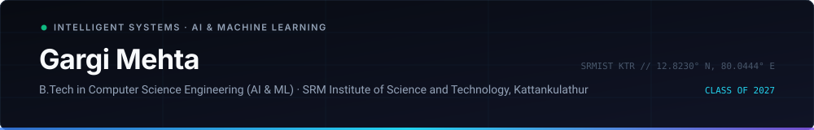

  <a href="#about">About</a> &bull;
  <a href="#engineering-approach">Engineering Approach</a> &bull;
  <a href="#meet-the-core-systems">Core Systems</a> &bull;
  <a href="#technologies--tools">Technologies</a> &bull;
  <a href="#what-im-exploring">What I'm Exploring</a> &bull;
  <a href="#background--credentials">Credentials</a> &bull;
  <a href="#connect--collaborate">Contact</a>

  
  
  
  
  

# Gargi Mehta: Artificial Intelligence, Deep Learning & Sustainable Systems

**TL;DR:** [Gargi Mehta](https://gaargimehta.github.io/Gaargimehta/) is a Computer Science undergraduate specializing in Artificial Intelligence and Machine Learning at [SRM Institute of Science and Technology, Kattankulathur](https://www.srmist.edu.in/) (Class of 2027, CGPA 8.2). Her work focuses on applied machine learning, convolutional computer vision, pediatric clinical decision support, and verifiable clean-tech architectures for battery lifecycle verification.

* [Blockchain Battery Passport](https://github.com/Gaargimehta/blockchain-battery-passport): Machine learning-based State-of-Health (SOH) and Remaining Useful Life (RUL) estimation with cryptographic on-chain attestations for EV battery circularity.
* [NutriVision](https://github.com/Gaargimehta/Nutivision): Computer vision and deep convolutional neural networks for meal classification, portion estimation, and nutritional decomposition.
* [UPJ Obstruction Clinical Decision ML](https://github.com/Gaargimehta/upj-obstruction-ml): Clinically aligned pediatric nephrology decision support system.
* [Smart City Pothole Detection](https://github.com/Gaargimehta/Potholes-detection): Real-time GPU-accelerated YOLOv8 hazard pipeline with automated GPS coordinate tagging.
* [LexGuard]: Multilingual legal document risk assessment and contract clause simplification across Indian regional languages.
* [Smart Market Watchlist](https://github.com/Gaargimehta/groww-code-watchlist): Full-stack market intelligence engine surfacing statistical anomaly scores without noise.

---

## About

Hi, I'm Gargi Mehta.

I'm a Computer Science undergraduate specializing in Artificial Intelligence and Machine Learning at SRMIST Kattankulathur.

I'm interested in building intelligent systems, exploring emerging technologies, and developing software that solves meaningful problems. My work combines empirical machine learning, deep neural vision pipelines, and verifiable data architectures.

Currently learning, experimenting, and building my way toward becoming an AI/ML engineer.

---

## Engineering approach

My engineering methodology prioritizes three core principles:

1. **Empirical rigor and validation:** Avoiding black-box assumptions by pairing machine learning models (XGBoost, deep CNNs, PyTorch networks) with structured evaluation metrics, rigorous cross-validation, and error analysis.
2. **Domain-grounded utility:** Designing systems tailored to high-consequence domains &mdash; whether assisting pediatric urologists in evaluating renal obstruction risk, computing battery degradation telemetry for second-life clean-tech valuation, or detecting road hazards for smart cities.
3. **Verifiable and sustainable architecture:** Ensuring pipelines remain maintainable, computationally efficient, and verifiable through clean containerization, lightweight endpoints, and cryptographically signed data structures where trust is required.

---

## Meet the core systems

| System | Focus area | Core stack | Documentation / Repository |
| :--- | :--- | :--- | :--- |
| [Blockchain Battery Passport](https://github.com/Gaargimehta/blockchain-battery-passport) | EV battery SOH &amp; RUL degradation estimation | Python, XGBoost, Scikit-learn, Blockchain, Streamlit | [Repository &amp; Overview](https://github.com/Gaargimehta/blockchain-battery-passport#readme) |
| [NutriVision](https://github.com/Gaargimehta/Nutivision) | Automated food recognition, portion size &amp; calorie estimation | Python, TensorFlow, OpenCV, CNNs, Pandas | [Repository &amp; Overview](https://github.com/Gaargimehta/Nutivision#readme) |
| [UPJ Obstruction Clinical ML](https://github.com/Gaargimehta/upj-obstruction-ml) | Pediatric nephrology decision support &amp; risk stratification | Python 3.10+, PyTorch 2.0+, XGBoost, Scikit-learn | [Repository &amp; Overview](https://github.com/Gaargimehta/upj-obstruction-ml#readme) |
| [Smart City Pothole Detection](https://github.com/Gaargimehta/Potholes-detection) | Real-time edge computer vision &amp; spatial hazard alerting | Python, YOLOv8, PyTorch, CUDA, OpenCV, FastAPI | [Repository &amp; Overview](https://github.com/Gaargimehta/Potholes-detection#readme) |
| [LexGuard](#lexguard--multilingual-legal-document-ai) | Multilingual legal contract auditing &amp; risk simplification | Python, NLP, Vector Embeddings, RAG, FastAPI | Research Prototype |
| [Smart Market Watchlist](https://github.com/Gaargimehta/groww-code-watchlist) | Statistical market anomaly detection &amp; attention scoring | Python, FastAPI, Docker, TypeScript, React | [Repository &amp; Overview](https://github.com/Gaargimehta/groww-code-watchlist#readme) |

 

<table>
<tr>
<td width="50%" valign="top">
<h4>🛰️ <a href="https://github.com/Gaargimehta/blockchain-battery-passport">Blockchain Battery Passport</a></h4>

A verifiable trust architecture pairing Machine Learning models (Random Forest, XGBoost) for <strong>State-of-Health (SOH)</strong> and <strong>Remaining Useful Life (RUL)</strong> estimation with cryptographically signed on-chain smart contract attestations for lithium-ion battery circularity and second-life valuation. Aligned with EU Regulation 2023/1542 and India Battery Waste Management Rules (BWMR) 2022.

<code>Python</code> &bull; <code>XGBoost</code> &bull; <code>Scikit-learn</code> &bull; <code>Blockchain</code> &bull; <code>Streamlit</code>

</td>
<td width="50%" valign="top">
<h4>🥗 <a href="https://github.com/Gaargimehta/Nutivision">NutriVision — AI Food Analyser</a></h4>

An end-to-end computer vision and deep learning pipeline analyzing meal imagery to detect food items, estimate portion volume and oil concentration, and calculate comprehensive nutritional values with automated health grading.

<code>Python</code> &bull; <code>TensorFlow</code> &bull; <code>OpenCV</code> &bull; <code>CNNs</code> &bull; <code>Pandas</code> &bull; <code>NumPy</code>

</td>
</tr>
<tr>
<td width="50%" valign="top">
<h4>🩺 <a href="https://github.com/Gaargimehta/upj-obstruction-ml">UPJ Obstruction Clinical Decision ML</a></h4>

A clinically aligned machine learning system designed to support clinicians in pediatric Ureteropelvic Junction (UPJ) obstruction management. Evaluates patient physiological indicators and diagnostic imaging biomarkers to provide risk stratification, aiding differential surgical triage.

<code>Python 3.10+</code> &bull; <code>PyTorch</code> &bull; <code>XGBoost</code> &bull; <code>Scikit-learn</code> &bull; <code>Streamlit</code>

</td>
<td width="50%" valign="top">
<h4>🛣️ <a href="https://github.com/Gaargimehta/Potholes-detection">Smart City Pothole Detection</a></h4>

An optimized real-time deep learning pipeline combining YOLOv8 with CUDA hardware acceleration for high-frame-rate road hazard bounding-box detection, automated GPS coordinate stamping, and municipal map integration.

<code>Python</code> &bull; <code>YOLOv8</code> &bull; <code>PyTorch</code> &bull; <code>CUDA</code> &bull; <code>FastAPI</code> &bull; <code>OpenCV</code>

</td>
</tr>
<tr>
<td width="50%" valign="top">
<h4>⚖️ LexGuard — Multilingual Legal Document AI</h4>

A natural language processing pipeline that audits commercial agreements, identifies high-risk indemnity and termination clauses, and translates complex legal terminology into 5 Indian regional languages (Hindi, English, Bengali, Tamil, Telugu) with grounded citations.

<code>Python</code> &bull; <code>NLP</code> &bull; <code>Vector DB</code> &bull; <code>RAG</code> &bull; <code>FastAPI</code>

</td>
<td width="50%" valign="top">
<h4>🌌 Distributed Systems &amp; Engineering</h4>

<b><a href="https://github.com/Gaargimehta/groww-code-watchlist">Smart Market Watchlist</a>:</b> Background statistical anomaly detection engine surfacing Attention Scores without market noise. 
<b><a href="https://github.com/Gaargimehta/Email-Job-Scheduler-Dashboard">Email Job Scheduler</a>:</b> Fault-tolerant distributed BullMQ + Redis job scheduling and real-time observability dashboard.

</td>
</tr>
</table>

---

## Technologies & tools

| Category | Technologies & Libraries |
| :--- | :--- |
| **Programming languages** | `Python`, `C`, `C++`, `Java`, `JavaScript`, `SQL` |
| **Machine learning & DL** | `PyTorch`, `TensorFlow`, `Scikit-learn`, `OpenCV`, `NumPy`, `Pandas`, `SciPy` |
| **Web & API frameworks** | `React`, `Flask`, `FastAPI`, `HTML5`, `CSS3` |
| **Platforms & developer tooling** | `Git`, `GitHub`, `Docker`, `VS Code`, `Jupyter Notebook`, `Google Colab` |

---

## What I'm exploring

| Domain | Focus & Active Inquiry |
| :--- | :--- |
| **Machine Learning Foundations** | Tree ensembles (XGBoost, LightGBM), loss topography, and regularized estimation |
| **Deep Learning Architectures** | Multi-head self-attention mechanics, convolutional vision pipelines, and transfer learning |
| **Data Structures & Algorithms** | Advanced graph traversals, dynamic programming patterns, and algorithmic optimization |
| **Generative AI & LLMs** | Retrieval-Augmented Generation (RAG) indexing, vector embeddings, and evaluation benchmarks |
| **Computer Vision** | Real-time object detection optimization, edge deployment, and spatial feature mapping |
| **Applied AI Systems** | Clinically aligned diagnostic systems and clean-tech battery lifecycle verification |

---

## Background & credentials

| Timeline | Milestone / Focus | Organization / Program | Status |
| :--- | :--- | :--- | :--- |
| **2023 &ndash; 2027** | B.Tech in Computer Science Engineering (AI &amp; ML) | SRM Institute of Science and Technology, Kattankulathur | May 2027 (CGPA: 8.2) |
| **Apr &ndash; Jun 2025** | Generative AI Virtual Intern | Google Cloud (AICTE-EduSkills) | Outstanding (O) Grade |
| **Mar 2026** | SAP Certified Data Analyst | SAP Analytics Cloud Global Certification | Certified |
| **2025** | Smart India Hackathon (SIH 2025) | Ministry of Education / AICTE | National Finalist |
| **2024** | OSSOME HACKS 2.0 | GitHub Community SRM | 36-Hour Hackathon |
| **Jun &ndash; Jul 2025** | Digital Literacy &amp; AI Volunteer Teacher | Mahatma Gandhi Govt. School, Alwar, Rajasthan | 50+ Rural Students Mentored |

---

## GitHub activity & metrics

Public GitHub activity snapshot for [@Gaargimehta](https://github.com/Gaargimehta):

<table border="0">
  <tr>
    <td align="center" width="50%">
      
    </td>
    <td align="center" width="50%">
      
    </td>
  </tr>
</table>

---

## Connect & collaborate

* **GitHub:** [@Gaargimehta](https://github.com/Gaargimehta)
* **LinkedIn:** [gargi-mehta](https://www.linkedin.com/in/gargi-mehta-a2ba36300/)
* **Portfolio Website:** [gaargimehta.github.io/Gaargimehta](https://gaargimehta.github.io/Gaargimehta/)
* **Email:** [gargimehta022@gmail.com](mailto:gargimehta022@gmail.com)
* **Resume:** [Gargi Mehta — Resume (PDF)](assets/Gargi_Mehta_Resume.pdf)

 

---

*"Building intelligent things, one commit at a time."*  
*Gargi Mehta &bull; SRM Institute of Science and Technology &bull; Class of 2027*

